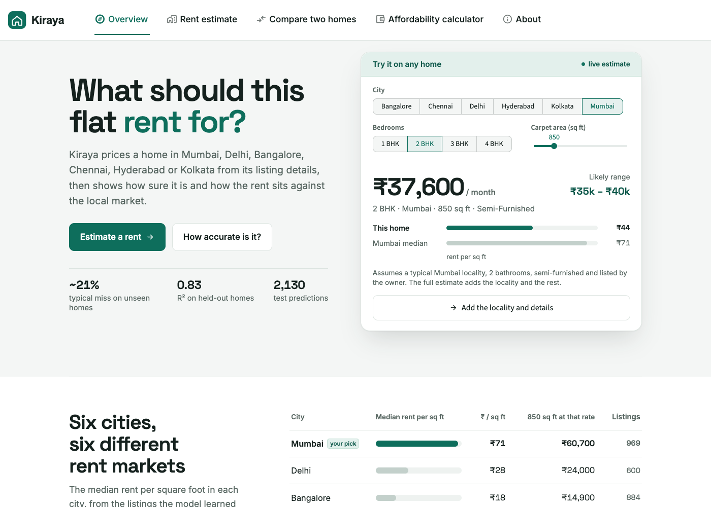
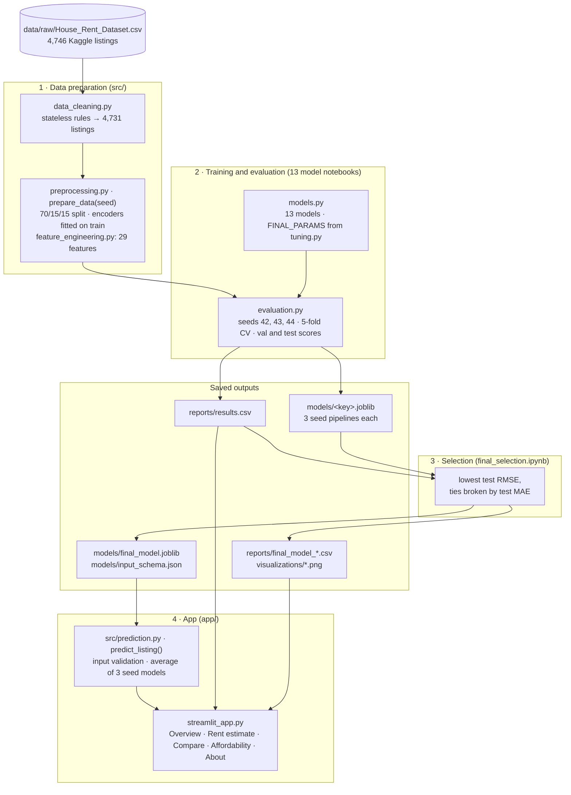
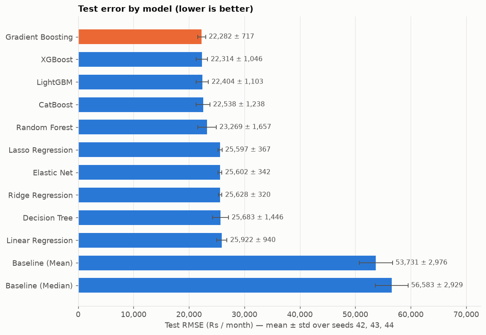
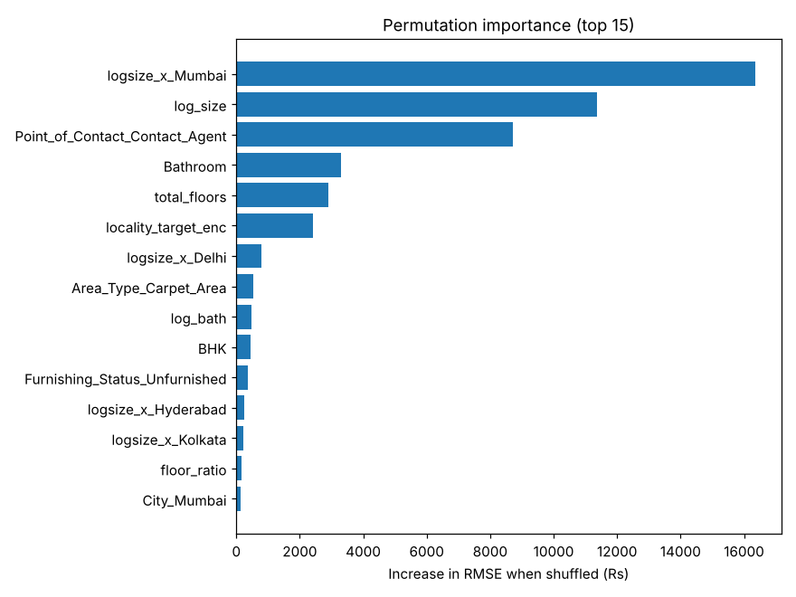
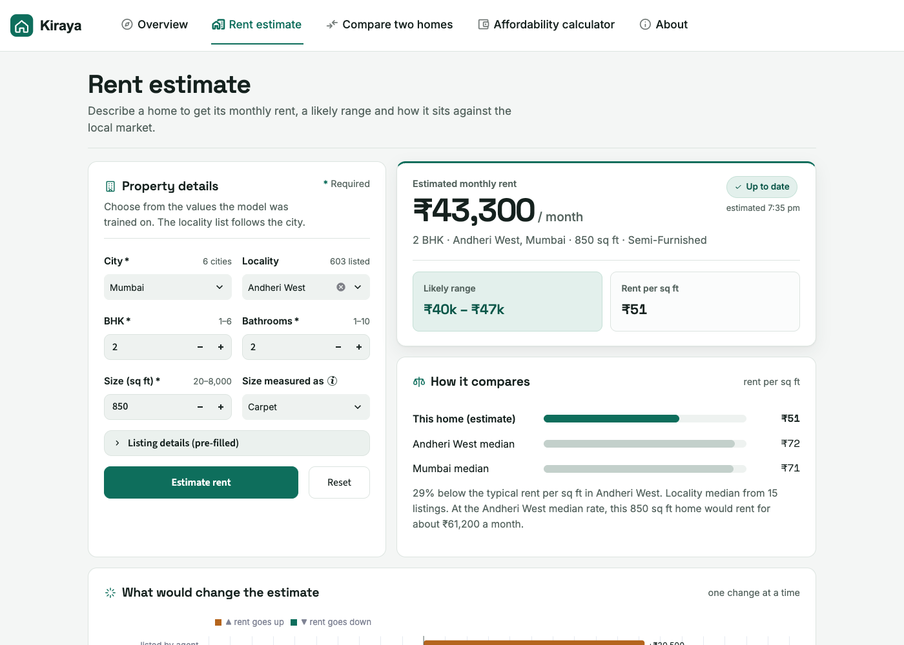
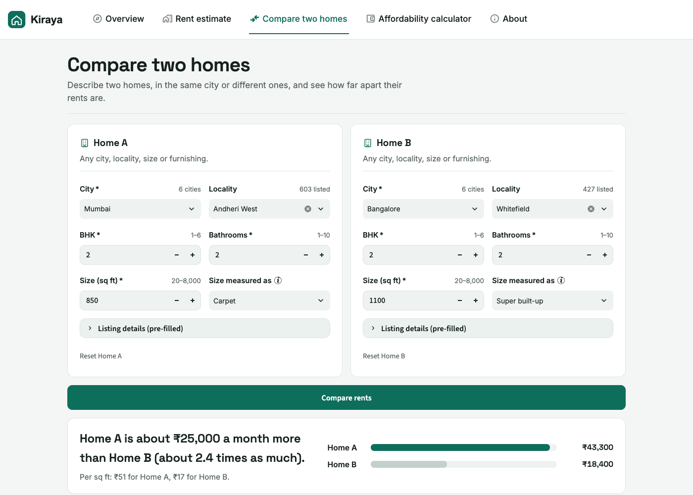
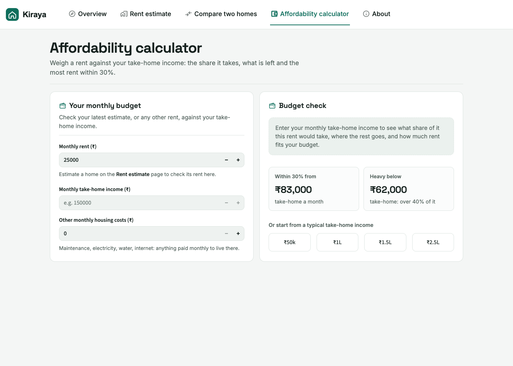
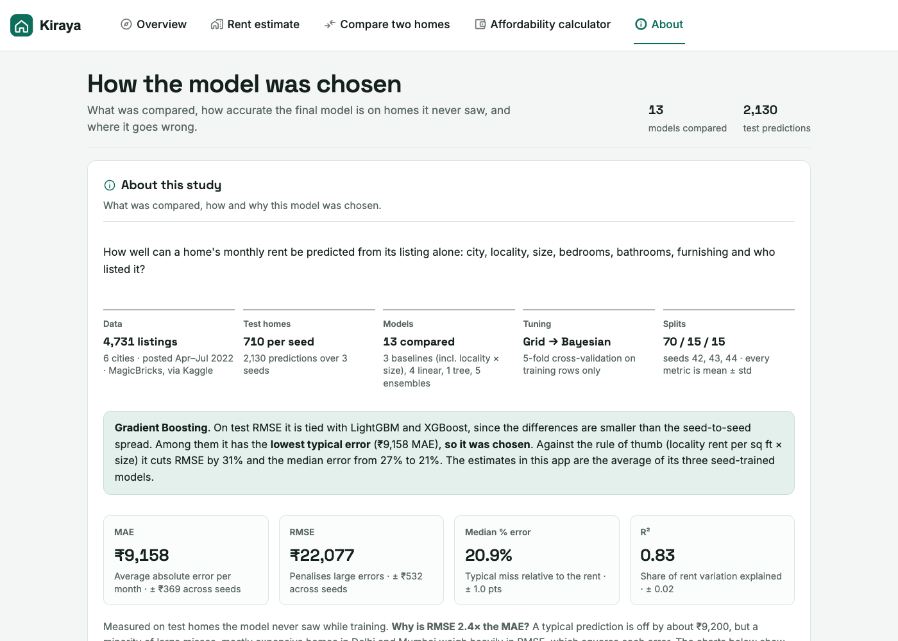

# Kiraya: House Rent Prediction

Kiraya (Hindi for *rent*) estimates the monthly rent of a flat or house in six Indian cities (Mumbai, Delhi,
Bangalore, Chennai, Hyderabad and Kolkata) from its listing details. Thirteen models, ten learned and three
baselines, were trained and scored on identical data across three random train/validation/test splits. The final
model, Gradient Boosting, powers a Streamlit app.

| Final model | Test RMSE | Test MAE | Median % error | R² |
|---|--:|--:|--:|--:|
| Gradient Boosting | ₹22,077 ± 532 | ₹9,158 ± 369 | 20.9% | 0.83 |
| Rule of thumb (locality rent per sq ft × size) | ₹31,953 ± 1,546 | ₹12,738 ± 664 | 26.9% | 0.65 |

Figures are test-set means ± standard deviation over seeds 42, 43 and 44, in rupees per month. Against the
locality × size rule of thumb, the model cuts RMSE by 31% and the median error from 27% to 21%.



## Contents

- [Key features](#key-features)
- [Architecture](#architecture)
- [Technology stack](#technology-stack)
- [Repository structure](#repository-structure)
- [Installation](#installation)
- [Configuration](#configuration)
- [Usage](#usage)
- [Experiments and results](#experiments-and-results)
- [Screenshots](#screenshots)
- [Dataset and licence](#dataset-and-licence)

## Key features

- A reproducible pipeline: one shared `src/` package, one notebook per model, and `run_all.py`, which runs every
  notebook in order and then the tests.
- Thirteen models compared on the same splits, including three baselines. The locality × size baseline is the rule
  of thumb a person would use, so it is the real bar to clear.
- Leakage checks: every encoder, scaler and filter is fitted on training rows only, and a data fingerprint confirms
  that every notebook saw the same rows for each seed.
- A Streamlit app with five pages:

| Page | What it does |
|---|---|
| Overview | Introduces the project, gives a live estimate for a quick example home, and compares rent per sq ft across the six cities. |
| Rent estimate | Describe a home and get its monthly rent, a likely range (the spread of the three seed models), rent per sq ft against the locality and city medians, and what would change the estimate. |
| Compare two homes | Two homes side by side and how far apart their rents are. |
| Affordability calculator | The latest estimate, or any rent, against your take-home income: share of income, what's left, and the most rent within the common 30% guideline. |
| About | The study at a glance, a leaderboard of all models, and where the final model goes wrong. |

The app only accepts values within the ranges seen in the data (for example 20 to 8,000 sq ft). Unusual or invalid
input gets a plain message instead of a Python error.

## Architecture



Every notebook imports the same `src/` code, so a notebook only picks which model to run and shows the results.
`data_exploration.ipynb`, `model_comparison.ipynb` and `feature_importance.ipynb` add figures to `visualizations/`.
The app needs only the saved files in `models/` and `reports/`; it never reads the dataset.

### Pipeline steps

1. **Clean.** Fixed rules, never hand-picked rows: normalise the text, keep physically valid listings, drop 6
   implausible ones (rent above ₹500 per sq ft) and 9 re-listed duplicates. That takes the data from 4,746 to
   4,731 listings.
2. **Split.** For each seed the data is split 70 / 15 / 15 into 3,311 training, 710 validation and 710 test rows,
   stratified on rent deciles. A far-out filter on rent per sq ft and a lower clip on size are learned from the
   training rows only. (With the ₹500 per sq ft rule already applied, the far-out filter removes no rows on any of
   the three seeds.)
3. **Build features.** Twenty-nine in all: size, bedrooms and bathrooms (also on a log scale), log size × city,
   one-hot encodings of city, furnishing, area type, tenant and contact, and the locality's typical rent from a
   cross-fitted target encoding. Floor and building height were tried and dropped; according to the note in
   `src/feature_engineering.py` they moved the error by only about ₹600.
4. **Learn log rent.** Rents run from ₹1,200 to ₹35 lakh, so the learned models predict log(1 + rent). All errors
   are reported in rupees.
5. **Tune.** A grid search first, then a Bayesian search (Optuna) around the best grid point, both scored by 5-fold
   cross-validation on the seed-42 training split. Library defaults, grid-best and Bayesian-best settings were then
   compared on test RMSE over the three seeds. The search log is in
   [`reports/final_hyperparameters.json`](reports/final_hyperparameters.json).
6. **Evaluate.** Each model runs on three seeds, and each seed draws a fresh split, fresh folds and fresh model
   randomness.
7. **Save.** Each model is stored as the average of its three seed-trained pipelines. The chosen one is copied to
   `models/final_model.joblib`, next to `models/input_schema.json`, which holds the allowed choices and value ranges
   the app uses.

## Technology stack

| Area | Tools |
|---|---|
| Language | Python 3.10 or newer |
| Data | pandas, NumPy |
| Models | scikit-learn (1.4 or newer), XGBoost, LightGBM, CatBoost |
| Tuning | Optuna |
| Notebooks and plots | Jupyter, nbclient, matplotlib |
| App | Streamlit (1.50 or newer), Altair |
| Testing and linting | pytest, ruff (settings in `pyproject.toml`) |

Exact minimum versions are in [`requirements.txt`](requirements.txt).

## Repository structure

```
├── app/                 Streamlit app: streamlit_app.py (entry), views/ (one file per page),
│                        common.py (form, estimates), ui.py (styles and components), assets/
├── data/README.md       how to get the dataset (data/ is git-ignored)
├── docs/screenshots/    screenshots of the app pages
├── notebooks/           data_exploration · one notebook per model (13) · hyperparameter_tuning ·
│                        model_comparison · final_selection · feature_importance · predict_demo
├── src/                 config · data_loading · data_cleaning · feature_engineering · preprocessing ·
│                        models · tuning · evaluation · plotting · prediction
├── tests/               test_pipeline.py (data, splits, leakage, validation, models) · test_app.py (the app)
├── reports/             results.csv · final_hyperparameters.json · final-model error summaries
├── visualizations/      figures saved by the notebooks
├── models/              saved models (built by run_all.py, git-ignored)
├── .streamlit/          app theme and server settings
├── run_all.py           runs every notebook in order, then the tests
├── requirements.txt     dependencies
└── pyproject.toml       project metadata, ruff and pytest settings
```

## Installation

You need Python 3.10 or newer. On macOS, XGBoost and LightGBM also need OpenMP (`brew install libomp`).

```bash
git clone https://github.com/PihuCodeTech/House-Rent-Prediction-System.git
cd House-Rent-Prediction-System
python3 -m venv .venv && source .venv/bin/activate
pip install -r requirements.txt
```

The dataset isn't included. Download it from Kaggle (see [`data/README.md`](data/README.md)) and save it unchanged
as `data/raw/House_Rent_Dataset.csv`.

## Configuration

| Setting | Where | Default |
|---|---|---|
| Seeds, split sizes, CV folds | `src/config.py` | seeds 42, 43, 44 · 70 / 15 / 15 · 5 folds |
| Training-only outlier filter, size clip | `src/config.py` (`FAR_OUT_K`, `CLIP_K`) | 3.0, 1.5 |
| Implausible-rent cut-off | `src/data_cleaning.py` (`MAX_RENT_PER_SQFT`) | ₹500 per sq ft |
| Model hyperparameters | `src/models.py` (`FINAL_PARAMS`) | results of the tuning notebook |
| Final model choice | `CHOICE` in `notebooks/final_selection.ipynb` | `None`: lowest test RMSE, ties broken by test MAE |
| App theme and server | `.streamlit/config.toml` | |

`src/config.py` also records reference hashes of the seed-42 split. A different pandas or scikit-learn version can
produce a different split. The notebooks then warn you, but all of them still share one split.

## Usage

```bash
python run_all.py                        # every notebook, then the tests
streamlit run app/streamlit_app.py       # the app, at http://localhost:8501
```

The app needs `models/final_model.joblib` and `models/input_schema.json`, which `run_all.py` creates. Until they
exist, the app shows a message asking you to run it.

| Command | Does |
|---|---|
| `python run_all.py --only random_forest` | re-runs only the named notebooks and keeps other results |
| `python run_all.py --tuning` | also re-runs the hyperparameter search (the notebook estimates 20 to 40 minutes) |
| `python run_all.py --no-tests` | skips the tests at the end |
| `python -m pytest` | runs the tests only (the app tests are skipped until the final model exists) |

`notebooks/predict_demo.ipynb` shows how to call `predict_listing` from Python, including how it handles missing
fields and invalid input.

## Experiments and results

All thirteen models, ranked by test RMSE. Median percentage error is the typical miss relative to a home's own
rent; unlike RMSE in rupees, a few very expensive homes don't pull it around. The full table, with train,
cross-validation and validation errors, is in [`reports/results.csv`](reports/results.csv).

| Model | Test RMSE (₹) | Test MAE (₹) | Median % error | Test R² |
|---|--:|--:|--:|--:|
| LightGBM | 22,012 ± 787 | 9,359 ± 397 | 21.5 ± 0.8 | 0.83 ± 0.02 |
| **Gradient Boosting** · final | **22,077 ± 532** | **9,158 ± 369** | **20.9 ± 1.0** | **0.83 ± 0.02** |
| XGBoost | 22,508 ± 1,103 | 9,346 ± 321 | 21.1 ± 0.7 | 0.82 ± 0.02 |
| CatBoost | 22,874 ± 1,061 | 9,386 ± 265 | 20.8 ± 0.5 | 0.82 ± 0.02 |
| Random Forest | 23,563 ± 1,591 | 9,931 ± 414 | 22.5 ± 0.5 | 0.81 ± 0.02 |
| Decision Tree | 25,059 ± 1,173 | 10,506 ± 643 | 24.2 ± 1.1 | 0.78 ± 0.01 |
| Elastic Net | 25,075 ± 622 | 10,357 ± 127 | 22.5 ± 1.0 | 0.78 ± 0.02 |
| Lasso Regression | 25,085 ± 658 | 10,362 ± 115 | 22.5 ± 1.1 | 0.78 ± 0.02 |
| Ridge Regression | 25,146 ± 675 | 10,357 ± 115 | 22.1 ± 0.9 | 0.78 ± 0.02 |
| Linear Regression | 25,680 ± 1,099 | 10,351 ± 209 | 21.8 ± 1.4 | 0.77 ± 0.01 |
| *Baseline: locality × size* | 31,953 ± 1,546 | 12,738 ± 664 | 26.9 ± 1.4 | 0.65 ± 0.01 |
| *Baseline: mean rent* | 53,731 ± 2,976 | 29,309 ± 166 | 112.3 ± 2.4 | 0.00 ± 0.00 |
| *Baseline: median rent* | 56,583 ± 2,929 | 23,617 ± 330 | 55.1 ± 0.7 | −0.11 ± 0.01 |

LightGBM, Gradient Boosting and XGBoost are within one standard deviation of the lowest test RMSE, so the selection
rule treats them as tied. Gradient Boosting won the tie-break with the lowest test MAE, and it also varies least
across seeds. Every learned model beats the locality × size rule by 20 to 31% on RMSE, but only by 3 to 6 points on
median percentage error. The rule already prices an ordinary flat well; the models help most on unusual and
expensive homes.

Validation errors are higher and swing much more between seeds than test errors. For Gradient Boosting, validation
RMSE is ₹31,807 ± 9,345 against a test RMSE of ₹22,077 ± 532. Model and hyperparameter choices used test RMSE,
not validation RMSE.

In the permutation importance on the seed-42 validation split, size matters most, especially in Mumbai. Whether an
agent lists the home and the number of bathrooms come next, ahead of the locality.

<p align="center">
  
  
</p>

On the 2,130 pooled test predictions ([`reports/final_model_errors.csv`](reports/final_model_errors.csv)), the
final model is least accurate in Delhi (26% median error) and on homes renting for ₹1 lakh or more (26%), and most
accurate on homes between ₹10k and ₹20k (18%).

## Screenshots

<p align="center">
  
  
</p>
<p align="center">
  
  
</p>

## Dataset and licence

The House Rent Prediction Dataset by Sourav Banerjee is on
[Kaggle](https://www.kaggle.com/datasets/iamsouravbanerjee/house-rent-prediction-dataset). It was collected from
[MagicBricks](https://www.magicbricks.com/) and holds 4,746 listings posted between April and July 2022. It is not
redistributed here.

The code is released under the [MIT Licence](LICENSE), which does not cover the dataset.
