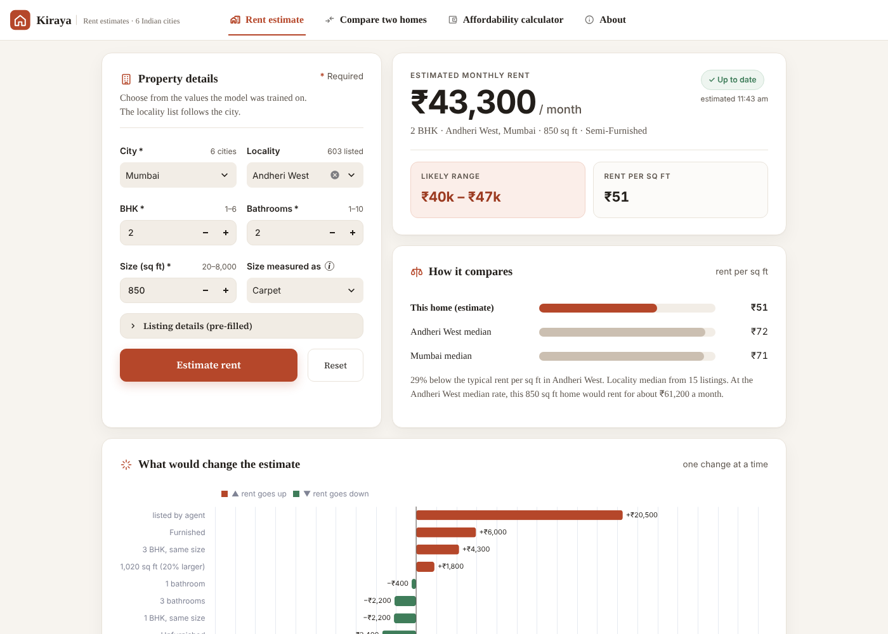

# Kiraya: House Rent Prediction

Kiraya (Hindi for *rent*) estimates the monthly rent of a flat or house in six Indian cities (Mumbai, Delhi,
Bangalore, Chennai, Hyderabad and Kolkata) from its listing details. Thirteen models were compared on identical data
across three random train/validation/test splits, with no data leakage, and the best of them drives a Streamlit app.

| Final model | Test RMSE | Test MAE | Median % error | R² |
|---|--:|--:|--:|--:|
| **Gradient Boosting** | ₹22,077 ± 532 | ₹9,158 ± 369 | 20.9% | 0.83 |
| Rule of thumb (locality rent per sq ft × size) | ₹31,953 ± 1,546 | ₹12,738 ± 664 | 26.9% | 0.65 |

Figures are mean ± standard deviation over seeds 42, 43 and 44, in rupees per month. Compared with the locality × size
rule of thumb that a person might reach for, the model lowers RMSE by 31% and the median error from 27% to 21%.



## Contents

- [Results](#results)
- [The app](#the-app)
- [How it works](#how-it-works)
- [Project structure](#project-structure)
- [Getting started](#getting-started)
- [Dataset and licence](#dataset-and-licence)

## Results

The table lists all thirteen models, best first. Median percentage error is the typical miss relative to a home's own
rent; unlike RMSE in rupees, it is not pulled around by a few very expensive homes. The full table, with train,
cross-validation and validation errors, is in [`reports/results.csv`](reports/results.csv).

| Model | Test RMSE (₹) | Test MAE (₹) | Median % error | Test R² |
|---|--:|--:|--:|--:|
| LightGBM | 22,012 ± 787 | 9,359 ± 397 | 21.5 ± 0.8 | 0.83 ± 0.02 |
| **Gradient Boosting** · final | **22,077 ± 532** | **9,158 ± 369** | **20.9 ± 1.0** | **0.83 ± 0.02** |
| XGBoost | 22,508 ± 1,103 | 9,346 ± 321 | 21.1 ± 0.7 | 0.82 ± 0.02 |
| CatBoost | 22,874 ± 1,061 | 9,386 ± 265 | 20.8 ± 0.5 | 0.82 ± 0.02 |
| Random Forest | 23,563 ± 1,591 | 9,931 ± 414 | 22.5 ± 0.5 | 0.81 ± 0.02 |
| Decision Tree | 25,059 ± 1,173 | 10,506 ± 643 | 24.2 ± 1.1 | 0.78 ± 0.01 |
| Elastic Net | 25,075 ± 622 | 10,357 ± 127 | 22.5 ± 1.0 | 0.78 ± 0.02 |
| Lasso Regression | 25,085 ± 658 | 10,362 ± 115 | 22.5 ± 1.1 | 0.78 ± 0.02 |
| Ridge Regression | 25,146 ± 675 | 10,357 ± 115 | 22.1 ± 0.9 | 0.78 ± 0.02 |
| Linear Regression | 25,680 ± 1,099 | 10,351 ± 209 | 21.8 ± 1.4 | 0.77 ± 0.01 |
| *Baseline: locality × size* | 31,953 ± 1,546 | 12,738 ± 664 | 26.9 ± 1.4 | 0.65 ± 0.01 |
| *Baseline: mean rent* | 53,731 ± 2,976 | 29,309 ± 166 | 112.3 ± 2.4 | 0.00 ± 0.00 |
| *Baseline: median rent* | 56,583 ± 2,929 | 23,617 ± 330 | 55.1 ± 0.7 | −0.11 ± 0.01 |

LightGBM, Gradient Boosting and XGBoost all fall within one standard deviation of the lowest test RMSE, so the three
are effectively tied. Gradient Boosting was chosen from among them because it has the lowest MAE and the smallest
variation across seeds. Every learned model beats the locality × size rule of thumb by 20–31% on RMSE, though the gain
narrows to 3–6 points on median percentage error: the rule already prices an ordinary flat well, and the models earn
their keep mainly on unusual and expensive homes. Size is the strongest predictor of rent, especially in Mumbai,
followed by whether an agent lists the home, the number of bathrooms and the locality.

<p align="center">
  
  
</p>

## The app

A Streamlit app built on the final model, with four pages:

| Page | What it does |
|---|---|
| **Rent estimate** | Describe a home and get its monthly rent, a likely range (the spread of the three seed models), rent per sq ft against the locality and city medians, and what would change the estimate. |
| **Compare two homes** | Two homes side by side and how far apart their rents are. |
| **Affordability calculator** | The latest estimate, or any rent, against your take-home income: share of income, what's left, and the most rent within the common 30% guideline. |
| **About** | The study at a glance, a leaderboard of all models, and where the model goes wrong. |

Inputs are limited to the ranges seen in the data, and unusual or invalid input produces a clear message rather than
an error.

## How it works

1. **Clean.** Fixed rules rather than hand-picked rows: normalise the text, keep physically valid listings, and remove
   6 implausible ones (rent above ₹500 per sq ft) and 9 re-listed duplicates. The data goes from 4,746 to 4,731
   listings.
2. **Split.** For each seed the data is divided 70 / 15 / 15 into training, validation and test sets, stratified on
   rent. Every encoder, scaler and filter is fitted on the training rows alone, and re-fitted inside each
   cross-validation fold.
3. **Features.** Twenty-nine in all: size, bedrooms and bathrooms (also on a log scale), size × city, one-hot
   encodings of city, furnishing, area type, tenant and contact, and the locality's typical rent from a cross-fitted
   target encoding. Floor and building height were tried and dropped, since they moved the error by only about ₹600.
4. **Learn log rent.** Rents run from ₹1,200 to ₹35 lakh, so the models learn log(1 + rent); all errors are reported
   back in rupees.
5. **Tune.** A grid search comes first, then a Bayesian search (Optuna) around the best grid point, both scored by
   5-fold cross-validation on the training data ([`reports/final_hyperparameters.json`](reports/final_hyperparameters.json)).
6. **Evaluate.** Every model is run on three seeds, each drawing a fresh split, fresh folds and fresh model
   randomness. A fingerprint check confirms that every model saw exactly the same data.
7. **Save.** Each model is stored as the average of its three seed-trained pipelines; the chosen one becomes
   `models/final_model.joblib`, alongside `models/input_schema.json`, which holds the allowed choices and value ranges
   the app uses.

## Project structure

```
├── app/                 Streamlit app — streamlit_app.py (entry), views/ (one file per page),
│                        common.py (form, estimates), ui.py (styles and components), assets/
├── data/README.md       how to get the dataset (data/ is git-ignored)
├── notebooks/           data_exploration · one notebook per model (13) · hyperparameter_tuning ·
│                        model_comparison · final_selection · feature_importance · predict_demo
├── src/                 config · data_loading · data_cleaning · feature_engineering · preprocessing ·
│                        models · tuning · evaluation · plotting · prediction
├── tests/               test_pipeline.py (data, splits, leakage, validation, models) · test_app.py (the app)
├── reports/             results.csv · final_hyperparameters.json · final-model error summaries
├── visualizations/      figures from the notebooks
├── models/              saved models (built by run_all.py, git-ignored)
└── run_all.py           runs every notebook in order, then the tests
```

## Getting started

```bash
git clone https://github.com/PihuCodeTech/House-Rent-Prediction-System.git
cd House-Rent-Prediction-System
python3 -m venv .venv && source .venv/bin/activate
pip install -r requirements.txt          # macOS: XGBoost and LightGBM also need `brew install libomp`
```

Download the dataset into `data/raw/House_Rent_Dataset.csv` (see [`data/README.md`](data/README.md)), then:

```bash
python run_all.py                        # every notebook, then the tests (about 3–4 minutes)
streamlit run app/streamlit_app.py       # the app, at http://localhost:8501
```

| Command | Does |
|---|---|
| `python run_all.py --only random_forest` | re-runs selected notebooks |
| `python run_all.py --tuning` | also re-runs the hyperparameter search (20–40 minutes) |
| `python -m pytest` | runs the tests only |

## Dataset and licence

The **House Rent Prediction Dataset** by Sourav Banerjee is on
[Kaggle](https://www.kaggle.com/datasets/iamsouravbanerjee/house-rent-prediction-dataset) and was collected from
[MagicBricks](https://www.magicbricks.com/): roughly 4,700 listings posted between April and July 2022. It is not
redistributed here.

The code is released under the [MIT Licence](LICENSE), which does not cover the dataset.
